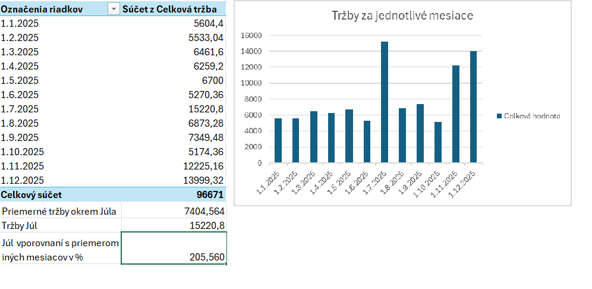
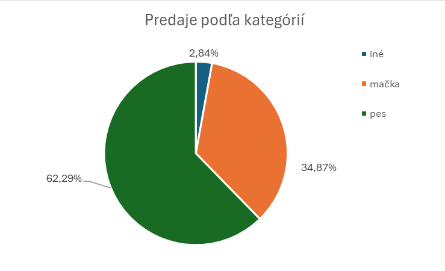

# 🐾 PetVille.sk – Dátová a predajná analýza e-shopu (2025)

[](#)
[](#)
[](#)

---

## 📌 1. Kontext a predstavenie projektu

**PetVille.sk** je slovenský e-shop zameraný na predaj krmiva, výživových doplnkov a chovateľských potrieb pre psy, mačky a drobné zvieratá. V roku 2025 e-shop vygeneroval celkový obrat **96 671,00 €**, čo predstavuje stabilný základ pre menší rodinný podnik v segmente chovateľských potrieb.

Manažment e-shopu potreboval získať hlbší vhľad do nákupného správania, sezónnych vplyvov a štruktúry sortimentu s cieľom:
- Identifikovať kľúčové ťahúne tržieb a odhaliť sezónne výkyvy.
- Vyhodnotiť predajný potenciál a efektivitu jednotlivých kategórií zvierat.
- Zlepšiť marketingové plánovanie, maržovosť a riadenie skladových zásob pre nadchádzajúci rok.

---

## 🎯 2. Ciele analýzy

1. **Výkonnostné metriky (KPIs):** Kvantifikovať celkový obrat, priemernú hodnotu objednávky (AOV) a počet položiek na nákup.
2. **Sezónnosť predaja:** Analyzovať mesačnú dynamiku tržieb a identifikovať kľúčové špičky dopytu.
3. **Analýza kategórií:** Zistiť prínos jednotlivých segmentov (psy vs. mačky vs. drobné zvieratá) v pomere k šírke ich ponuky.
4. **Produktová analýza (Top & Flop):** Identifikovať najpredávanejšie položky a odhaliť produkty s nízkym predajom alebo negatívnou spätnou väzbou.
5. **Kvalita a spokojnosť:** Analyzovať distribúciu zákazníckych recenzií a identifikovať problémové produkty ohrozujúce reputáciu značky.
6. **Štatistická verifikácia:** Overiť stanovené hypotézy pomocou inferenčnej štatistickej analýzy.

---

## 📊 3. Kľúčové ukazovatele (KPIs)

| Ukazovateľ | Hodnota | Poznámka |
| :--- | :---: | :--- |
| **Celkové tržby** | **96 671,00 €** | Stabilný ročný obrat rodinného podniku |
| **Predané kusy** | **8 753 ks** | Celkový objem predaných produktových jednotiek |
| **Sortiment** | **90 produktov** | Celkový počet unikátnych položiek v ponuke |
| **Priemerná hodnota objednávky (AOV)** | **16,42 €** | Výrazný priestor na zavedenie cross-sellingu |
| **Položky na objednávku** | **1,01 ks** | Zákazníci nakupujú takmer výlučne po jednom kuse |
| **Priemerné hodnotenie produktov** | **4,3 / 5,0** | Vysoká celková spokojnosť zákazníkov s portfóliom |

> ⚠️ **Kľúčové zistenie:** Priemerný počet položiek na objednávku (**1,01**) a nízka hodnota košíka (**16,42 €**) odhaľujú nevyužitý predajný potenciál. Kým drahšie produkty (napr. granule za 36,00 € či pelechy za 51,64 €) ťahajú obrat, celkovú AOV stláčajú masové jednorazové nákupy lacných položiek (konzervy za 2,80 €, maškrty). Zákazníci e-shop navštívia s cieľom kúpiť jednu konkrétnu vec a neodchádzajú s doplnkovým tovarom.

---

## 🔍 4. Hlavné zistenia a analytické výstupy

### A. Sezónnosť a mesačné trendy
- Predaj vykazuje **dva kľúčové vrcholy roka**: letný nárast v **júli** a predvianočnú nákupnú vlnu v **novembri a decembri**.
- **Júlový extrém:** V júli dosiahli tržby **15 220,80 €**, čo tvorí až **205,56 % priemernej mesačnej tržby** ostatných mesiacov (nárast o +105,56 % nad mesačným priemerom).
- Dôvodom tohto výkyvu bol primárne jeden produkt – *Chladiaca podložka Pup Republic CoolMat L*, ktorá v samotnom júli vygenerovala **9 592,80 €** (571 predaných kusov).



### B. Segmentácia podľa kategórií zvierat
- **Psy:** Tvoria **62,29 % celkových tržieb**. Ide o najziskovejší a najstabilnejší segment celého e-shopu.
- **Mačky:** Tvoria **34,87 % celkových tržieb**, hoci katalóg obsahuje širšiu ponuku položiek pre mačky než pre psy.
- **Ostatné drobné zvieratá:** Tvoria marginálny podiel **2,84 %**.
- *Záver:* Portfólio produktov pre mačky vykazuje nižšiu efektivitu a obratovosť na jednu zalistovanú položku, zatiaľ čo produkty pre psy sú hlavným motorom rastu.



### C. TOP 10 najúspešnejších produktov podľa tržieb

| # | Produkt | Kategória | Tržby | Predané kusy | Priemerná cena |
| :-: | :--- | :---: | ---: | ---: | ---: |
| 1. | **Granule Pupco Adult Chicken 3kg** | Psy | **15 660,00 €** | 435 ks | 36,00 € |
| 2. | **Chladiaca podložka Pup Republic CoolMat L** | Psy | **10 012,80 €** | 586 ks | 17,09 € |
| 3. | **Podstielka BellaMeow Silica Fresh 7,6l** | Mačky | **7 014,00 €** | 501 ks | 14,00 € |
| 4. | **Konzerva Pup Republic Beef Stew 400g** | Psy | **5 966,80 €** | 2 131 ks | 2,80 € |
| 5. | **Pelech Canine Craft Industries CozyDream L** | Psy | **5 525,48 €** | 107 ks | 51,64 € |
| 6. | **Maškrty Snouty Training Bites 200g** | Psy | **5 112,00 €** | 852 ks | 6,00 € |
| 7. | **Pelech CozyNest DreamCat sivý** | Mačky | **4 492,68 €** | 87 ks | 51,64 € |
| 8. | **Vôdzka Tail Trend RopeWalk 5m** | Psy | **4 449,20 €** | 227 ks | 19,60 € |
| 9. | **Šampón Dogissimo Sensitive 300ml** | Psy | **3 696,00 €** | 420 ks | 8,80 € |
| 10. | **Granule Catissime Premium Salmon 2kg** | Mačky | **2 562,00 €** | 61 ks | 42,00 € |

> 💡 **Koncentrácia tržieb:** Týchto TOP 10 položiek tvorí **64 490,96 €**, čo predstavuje až **66,71 % celkového obratu** e-shopu. Len 11 % ponuky (10 produktov z 90) generuje dve tretiny všetkých príjmov.

### D. Hodnotenia a problémové produkty
- Celkovo v e-shope prevládajú pozitívne 4- a 5-hviezdičkové hodnotenia (celkový priemer portfólia je **4,3 / 5,0**).
- **Kritický produkt:** Vôdzka **Tail Trend UrbanFlex 3m** dosiahla priemer len **1,6 / 5,0** (na základe 13 overených recenzií). Recenzie opakovane poukazujú na nekvalitné materiály, zlyhávajúce karabíny a nespokojnosť zákazníkov, čo prináša zvýšené riziko vratiek a poškodzovania dobrého mena značky. Na základe preskúmaných recenzií odporúčame zvážiť vyradenie produktu z ponuky.

---

## 📐 5. Štatistická analýza

Na rigorózne potvrdenie hypotéz boli aplikované štatistické metódy:

1. **Dvojvýberový t-test s predpokladom rovnosti rozptylov (Psy vs. Mačky):**
   - **Hypotéza:** Testoval sa rozdiel v priemernej hodnote tržby na riadok nákupu medzi sortimentom pre mačky (priemer 17,30 €) a pre psy (priemer 16,23 €) pri hladine významnosti $\alpha = 0,05$.
   - **Použitý vzorec v Exceli:** `=TTEST(A2:A1949, B2:B3712, 2, 2)`
   - **Výsledok:** Hodnota **$p = 0,0054$** ($p < 0,01$). Rozdiel je štatisticky vysoko signifikantný. Zákazníci pri mačkách síce generujú vyššiu priemernú tržbu na položku, no psí sortiment tvorí dominantný obrat firmy vďaka výrazne vyššiemu objemu transakcií (3 711 vs. 1 948 nákupov).
2. **Analýza sezónnych odchýlok:**
   - Preukázala júlovú anomáliu (**205,56 % priemeru ostatných mesiacov**), ťahanú jedným sezónnym produktom (*Chladiaca podložka Pup Republic CoolMat L*), ktorý vygeneroval 9 592,80 € v priebehu jediného mesiaca.

---

## 💡 6. Strategické odporúčania pre e-shop

1. **Zvýšenie priemernej hodnoty košíka (Cross-selling / Bundling):**
   - Zaviesť na detaile produktu a priamo v nákupnom košíku funkciu *„Zákazníci tiež kúpili“* s ponukou relevantných doplnkov (napr. konzerva alebo tréningové maškrty k vrecu granúl), aby sa prekonal nízky priemer 1,01 položky na objednávku.
   - Vytvoriť cenovo zvýhodnené produktové balíčky (napr. *Granule + Šampón* alebo *Vôdzka + Maškrty*).
   - Nastaviť prah dopravy zdarma na úroveň **25,00 – 30,00 €** (aktuálna AOV je len 16,42 €), čím sa zákazníci prirodzene motivujú pridať do košíka druhú položku.
2. **Včasné plánovanie sezónnych kampaní a predzásobenie:**
   - Overiť maržovosť júlového hitu (*Chladiaca podložka Pup Republic CoolMat L*) a v prípade dostatočnej ziskovosti spustiť letnú kampaň už v máji/júni so zabezpečením dostatočných skladových zásob.
3. **Optimalizácia štruktúry sortimentu:**
   - Prehodnotiť mačací sortiment, ktorý tvorí až 56,7 % katalógu, no len 34,9 % tržieb. Zredukovať ležiaky a uvoľnený kapitál alokovať do stabilnejšieho psieho sortimentu.
4. **Vyradenie chybného tovaru a reklamácia:**
   - Prebrať nízke hodnotenie vôdzky *Tail Trend UrbanFlex 3m* s dodávateľom a zvážiť výmenu produktu alebo ukončenie jeho predaja.
5. **Pravidelný monitoring metrík:**
   - Zaviesť pravidelné mesačné prehľady tržieb, kategórií, obrátkovosti zásob a zákazníckych recenzií.

---

## 🛠️ 7. Dátové spracovanie a metodika (Excel)

- **Čistenie a audit dát:**
  - Odstránenie 209 duplicitných riadkov z pôvodného exportu (finálna vzorka: 5 952 objednávkových riadkov a 5 887 unikátnych objednávok).
  - Očistenie a konverzia textových hodnotení na číselné hodnoty s ošetrením chýbajúcich údajov (`IF`, `VALUE`).
- **Transformácia a kalkulácie:**
  - Výpočet tržieb na riadok objednávky a normalizácia dátumov na začiatok mesiaca pre časové rady (`DATE`, `YEAR`, `MONTH`).
  - Textová kategorizácia sortimentu na psí, mačací a iný segment pomocou reťazcových funkcií (`SEARCH`, `ISNUMBER`, vnorené `IF`).
- **Agregácia a vizualizácia:**
  - Využitie kontingenčných tabuliek (Pivot Tables) a súhrnných funkcií (`AVERAGE`, `SUM`) na výpočet kľúčových KPI (AOV 16,42 €, 1,01 položky/objednávka).
  - Mesačné a kategóriové grafy pre interpretáciu trendov a produktových anomálií.
- **Štatistické testovanie:**
  - Realizácia dvojvýberového Studentovho t-testu pomocou funkcie `TTEST` na porovnanie priemerov medzi kategóriami.

---

## 📁 8. Štruktúra repozitára

```text
petville-analyza-predaja-excel/
├── .gitignore
├── README.md
├── data/
│   ├── raw/
│   │   └── petville_predaje_2025_raw.csv           # Pôvodný nespracovaný export (6 161 riadkov)
│   └── processed/
│       └── petville_predaje_2025_processed.csv     # Očistené dáta po odstránení 209 duplicít (5 952 riadkov)
├── excel/
│   └── Petville_predajna_analyza_2025.xlsx         # Analytický zošit s dátami, kontingenčnými tabuľkami a t-testom
├── outputs/
│   ├── PetVille_zaverecny_report_2025.pdf          # Finálna manažérska správa vo formáte PDF
│   └── PetVille_zaverecny_report_2025.docx         # Editovateľná verzia správy vo formáte MS Word
└── images/
    ├── mesacna_sezonnost.png                       # Graf mesačného vývoja tržieb a júlovej špičky
    └── rozdelenie_kategorii.png                    # Koláčový graf podielu tržieb podľa druhu zvierat
```
